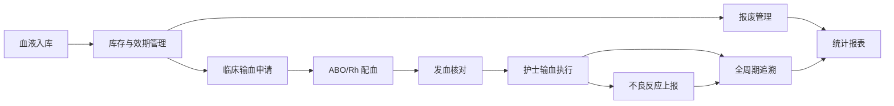
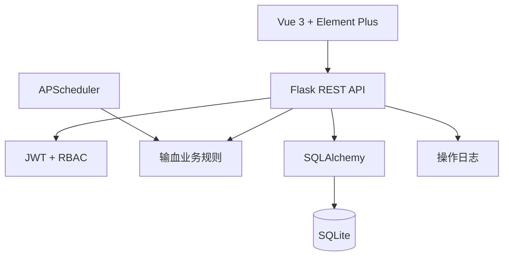

# 输血管理分系统

面向医院输血科与临床用血场景的一体化管理系统，覆盖血液入库、库存与效期、临床申请、ABO/Rh 配血、发血核对、护士执行、不良反应、全周期追溯、报废与统计的完整业务闭环。

系统采用前后端分离架构，面向 PC 桌面端设计，支持本地离线部署。业务规则依据《临床输血技术规范》中的相容性、复检、发血核对与追溯要求实现，重点解决血液流通过程中状态不透明、效期风险高、配血依赖人工判断和跨环节追溯困难的问题。

## 业务闭环



## 核心能力

| 模块 | 能力描述 |
| --- | --- |
| 血液入库 | 单袋与批量入库，自动生成储血号，按品种计算有效期，强制录入七项复检结果 |
| 库存管理 | 效期倒计时、临期与过期高亮、筛选查询、袋签打印、批量报废、冰箱分布视图 |
| 输血申请 | 患者信息、血型与 Rh、品种数量、紧急程度登记，申请状态全程可查 |
| 配血工作台 | 按品种、血型、Rh 与 FEFO 推荐血袋，自动完成 ABO/Rh 相容性判断 |
| 发血工作台 | 申请单、血袋归属、效期、配血结论四项核对，校验通过后生成发血记录 |
| 输血执行 | 护士领血核对与执行确认，记录执行人和执行时间 |
| 不良反应 | 发热、过敏、溶血等反应登记，支持程度、处理措施与上报状态 |
| 全周期追溯 | 按住院号聚合申请、配血、发血、执行与不良反应事件 |
| 预警中心 | 临期、过期、低库存、待配血超时、复检未完成自动扫描与处理闭环 |
| 统计报表 | 出入库趋势、血型库存、科室用血、不良反应分布与 CSV 导出 |
| 系统管理 | 用户、角色、科室、品种字典、冰箱与操作日志管理 |

## 功能亮点

### 真实的临床用血规则

- 红细胞类按供受者抗原抗体矩阵判断，血浆与冷沉淀采用相反规则，血小板支持同型优先与异型提示。
- Rh 阴性受者仅接受 Rh 阴性血液；Rh 阳性受者接受 Rh 阴性血液时给出提示。
- 前端展示相容、警告、不相容三档结果；后端提交时再次校验，避免绕过界面造成错误配血。
- 发血前逐项核验申请单状态、血袋锁定归属、有效期与相容配血记录。

### 可讲清楚的业务闭环

- 血袋从在库、备血锁定、已发血到已报废，状态流转清晰可追踪。
- 配血、发血、执行与不良反应相互联动，取消配血会自动解锁血袋。
- 每一次关键操作写入操作日志，便于审计与问题定位。

### 主动预警而非被动查询

- APScheduler 启动即扫描，之后按固定周期持续检查。
- 预警覆盖临期、过期、低库存、待配血超时与复检未完成。
- 同对象同类型未处理预警自动去重，铃铛红点仅统计警告与严重级别。

### 面向临床场景的打印与追溯

- 提供 A4 输血记录单与血袋标签打印视图。
- 袋签包含二维码、血型、Rh、有效期与关键核对信息。
- 追溯页面以时间轴串联完整输血链路，不相容与不良反应节点突出显示。

## 角色与权限

| 角色 | 主要职责 |
| --- | --- |
| 血库管理员 | 全流程管理、基础字典维护、用户与权限管理 |
| 输血科技师 | 血液入库、配血、发血、报废申请与库存管理 |
| 临床医生 | 提交输血申请并查看申请进度 |
| 护士 | 领血核对、执行确认、不良反应上报 |
| 科室主任 | 报废审批、统计报表与预警处理 |

系统采用 JWT 鉴权与后端 RBAC 双重校验，前端菜单按角色动态呈现，越权请求会被后端拒绝并记录。

## 技术架构



| 层次 | 技术选型 |
| --- | --- |
| 前端 | Vue 3、Vite、Vue Router、Pinia、Axios、Element Plus、ECharts |
| 后端 | Python 3.10+、Flask、Flask-SQLAlchemy、Flask-JWT-Extended、Flask-CORS |
| 数据 | SQLite，默认数据库文件 `backend/data/bloodbank.db` |
| 定时任务 | APScheduler，启动即扫描并按周期执行 |
| 打印 | 浏览器打印与独立 `@media print` 样式 |
| 部署 | 本地单机部署，全部依赖离线安装，不依赖 CDN 或在线字体 |

## 界面与交互

- 业务页面采用医疗蓝主色、轻量描边与低饱和状态色，保持信息密度与可读性。
- 页面标题、统计卡叠加低透明度 SVG 纹理，关键操作按钮使用渐变强调、组件图标与悬停扫光。
- 表格操作列统一由 `TableActions` 渲染，最多三个操作保持单行，超出自动折叠。
- 路由按模块懒加载，配合 `RouteLoading` 骨架与路由级异常兜底，避免页面白屏。
- 支持暗色模式，并遵循 `prefers-reduced-motion` 降低动态效果。

## 快速开始

### 环境要求

- Windows 10 / 11
- Python 3.10 及以上
- Node.js 18 及以上

### 启动服务

后端：

```powershell
cd backend
python -m venv .venv
.\.venv\Scripts\Activate.ps1
pip install -r requirements.txt
python init_db.py
python app.py
```

前端：

```powershell
cd frontend
npm install
npm run dev
```

访问地址：

- 前端：`http://127.0.0.1:5173`
- 后端：`http://127.0.0.1:5000`

### 体验账号

所有账号密码统一为 `123456`。

| 用户名 | 角色 |
| --- | --- |
| `admin` | 血库管理员 |
| `tech` | 输血科技师 |
| `doctor` | 临床医生 |
| `nurse` | 护士 |
| `director` | 科室主任 |

## 测试与质量

后端核心流程使用 `pytest` 运行，测试数据库为内存 SQLite，不会修改业务数据。

```powershell
cd backend
python -m pytest -q
```

覆盖范围包括登录鉴权与越权拦截、系统管理接口 `403`、ABO/Rh 相容性矩阵、入库复检、配血与发血、执行确认、不良反应、追溯、预警去重、报表权限和发血审计日志。

主流程 HTTP 验收脚本：

```powershell
cd backend
python tests/e2e_api.py --base-url http://127.0.0.1:5000/api
```

脚本会真实走通入库、申请、配血、发血、执行、不良反应、追溯、审计日志与越权校验，成功时输出 `ACCEPTANCE PASSED`。

前端构建检查：

```powershell
cd frontend
npm run build
```

## 项目结构

```text
YiYuanXinXi/
├─ backend/
│  ├─ app.py                 # Flask 应用工厂、蓝图注册、JWT 错误处理
│  ├─ config.py              # 配置与数据库路径
│  ├─ models.py              # 核心数据模型
│  ├─ init_db.py             # 建表与种子数据
│  ├─ routes/                # 登录、入库、申请、配血、发血、预警等接口
│  ├─ utils/                 # JWT/RBAC、相容性规则、预警扫描
│  └─ tests/                 # 核心业务流程测试
├─ frontend/
│  ├─ src/api/               # Axios 封装与接口集合
│  ├─ src/components/        # 业务组件、SVG 装饰与表格操作列
│  ├─ src/layouts/           # 顶栏与侧边栏主框架
│  ├─ src/views/             # 业务页面与打印视图
│  └─ src/styles/            # 主题、交互、视觉与打印样式
└─ docs/                     # 技术方案与项目文档
```

## 部署与数据说明

- 数据库为本地 SQLite 文件，适合单机部署与离线环境。
- `python init_db.py` 会重建表并写入基础数据，执行前请确认无需保留现有数据。
- 生产或真实业务环境应配置独立密钥、HTTPS、数据库备份与访问审计。
- 本项目用于管理软件与输血业务实践，不替代医院正式信息系统或临床决策，实际使用需按所在机构规范完成验收。

## 文档

- 技术方案与数据库设计：[docs/design.md](docs/design.md)
- 功能核验与系统边界：[docs/验收说明.md](docs/验收说明.md)
- 现场演示与测试命令：[docs/验收操作手册.md](docs/验收操作手册.md)
- AI 协作过程与人工介入：[docs/AI协作记录.md](docs/AI协作记录.md)
